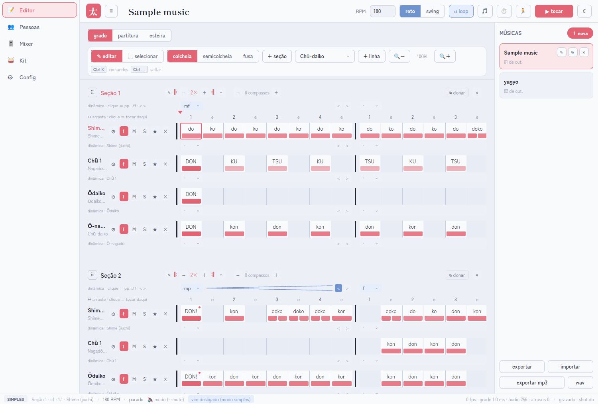
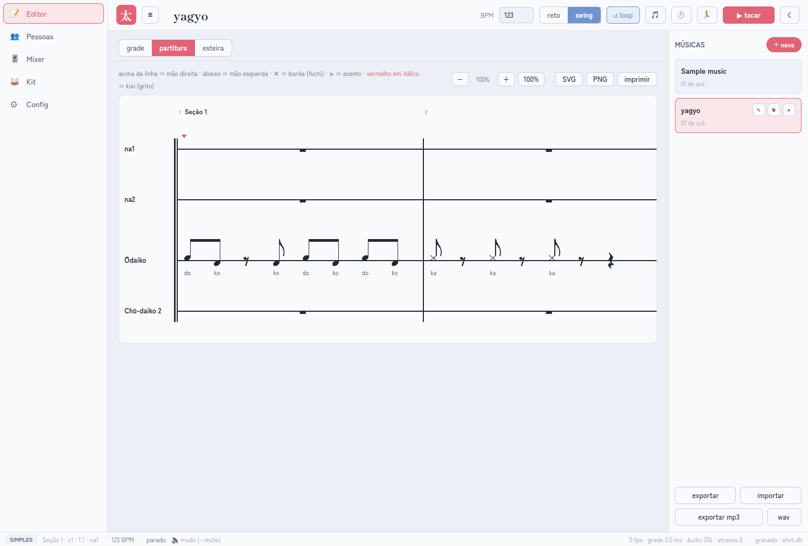
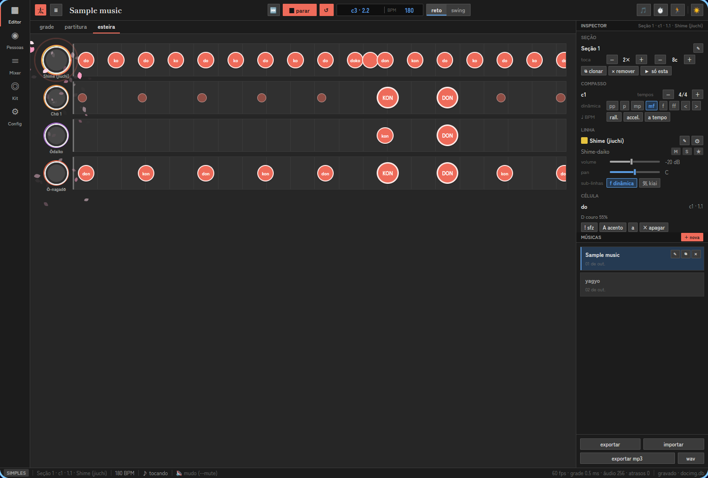
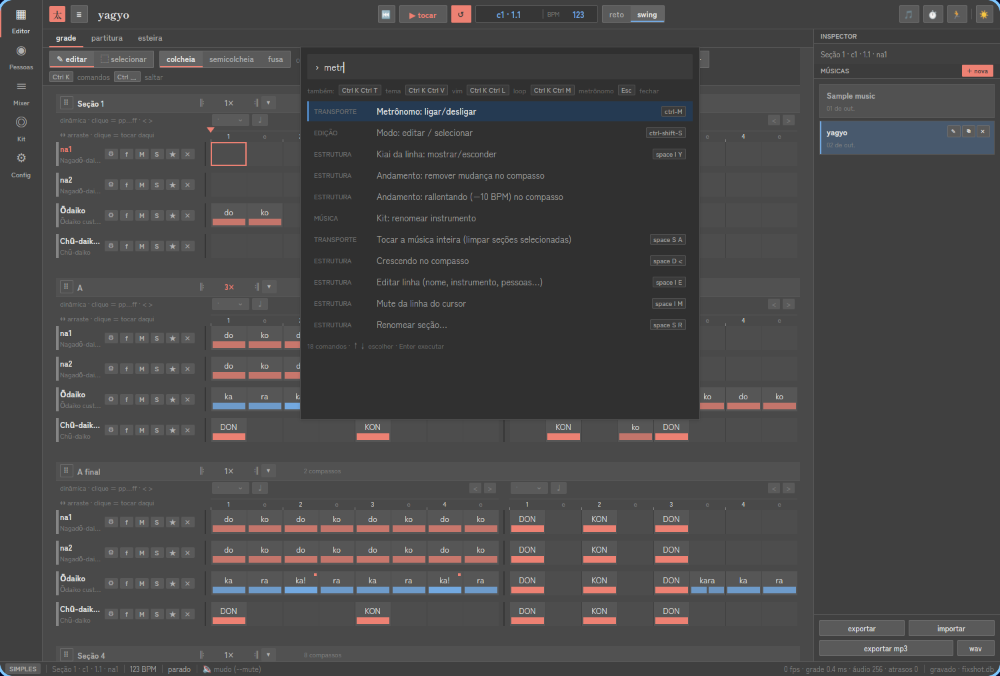
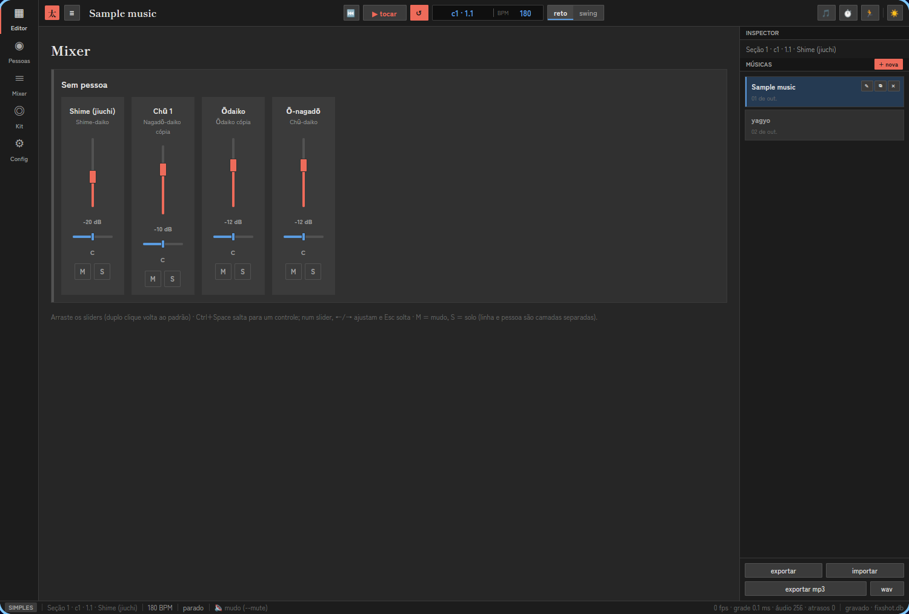

# WaDAWko

Editor de partituras e "DAW" para grupos de **taiko**, escrito em **kuchi shōga** — as sílabas
faladas dos tambores (`don`, `doko`, `ka`, `tsuku`…). Escreva numa grade por instrumento, ouça
com samples reais, veja a partitura e ensaie com a esteira de notas.

App desktop nativo em **Rust + [GPUI](https://www.gpui.rs/)** para Linux. O app web original
(Svelte) está na tag `web-final`.



| Partitura | Esteira (ensaio) |
|---|---|
|  |  |
| **Paleta de comandos** (`Ctrl+K`) | **Mixer** |
|  |  |

## O que dá para fazer

- **Escrever** digitando sílabas na grade — seções com ritornello, dinâmicas, crescendo,
  kiai, sforzando, frases prontas do repertório; pegar notas e arrastar (com `Alt`, copiar).
- **Organizar** quem toca o quê: pessoas com cor e caneta, linhas compartilhadas, mixer.
- **Ouvir e ensaiar**: loop, metrônomo, count-in, swing, treino que acelera a cada volta,
  tocar só as seções escolhidas; instrumentos ajustáveis no Kit.
- **Exportar**: música em JSON, áudio em WAV/MP3, partitura em SVG/PNG/PDF.
- **Teclado primeiro**: paleta, saltos por rótulo, which-key e vim opcional.

## Baixar

Para Linux x86_64 em **[Releases](https://github.com/aqilputi/wadawko/releases)**: um **AppImage**
(`chmod +x` e rode) ou o pacote que instala em `~/.local` com atalho no menu:

```sh
tar xzf wadawko-*-linux-x86_64.tar.gz
cd wadawko-*-linux-x86_64 && ./install.sh      # instala em ~/.local
wadawko
```

Requer GPU com Vulkan (Mesa serve), PipeWire/ALSA e glibc ≥ 2.39; `ffmpeg` só para MP3.
Vindo do app web ou de outro PC? **Config → importar músicas** e escolha o `wadawko.db` antigo
(ou um backup `.json`).

## Compilar

```sh
git clone https://github.com/aqilputi/wadawko.git && cd wadawko
cargo build --release -p wadawko-app          # binário em target/release/wadawko
```

Dependências de sistema e detalhes: [instalar e compilar](docs/guias/instalar-e-compilar.md).
A [CI](.github/workflows/ci.yml) compila e testa todo push; `tools/package.sh` gera o mesmo
pacote do release localmente.

## Documentação

Tudo está em [`docs/`](docs/index.md) — um bundle
[OKF v0.2](https://github.com/GoogleCloudPlatform/open-knowledge-format) (markdown com
frontmatter, legível por pessoas e agentes):

- [Visão geral](docs/visao-geral.md) · [Guia de uso](docs/guias/uso.md) · [Atalhos](docs/referencia/atalhos.md)
- [Linha de comando](docs/referencia/linha-de-comando.md) · [Vocabulário](docs/referencia/vocabulario.md) ·
  [Formato da música](docs/referencia/formato-da-musica.md) · [Dados e arquivos](docs/referencia/dados-e-arquivos.md)
- [Arquitetura](docs/arquitetura/workspace.md) · [Contribuir](docs/desenvolvimento/contribuir.md) ·
  [Testes](docs/desenvolvimento/testes-e-depuracao.md) · [Desempenho](docs/desenvolvimento/desempenho.md)
- [Planos e roadmap](docs/planejamento/index.md) · [Histórico de versões](CHANGELOG.md)

## Créditos

Samples de taiko: SCC Taiko Drums (CC BY-SA 4.0), freesound (CC BY 3.0 / CC0; vozes dos kiai
CC0 / CC BY 3.0 / CC BY 4.0), animalese.js (CC BY 4.0).
Fontes: Zen Kaku Gothic New, Shippori Mincho e Bravura (SIL OFL). Detalhes em
[créditos](docs/creditos.md) e no [`NOTICE`](NOTICE).

## Licença

O código é licenciado sob **MIT** ou **Apache-2.0**, à sua escolha
([`LICENSE-MIT`](LICENSE-MIT), [`LICENSE-APACHE`](LICENSE-APACHE)). Os samples e as fontes
embutidos mantêm as licenças deles (acima). Contribuições enviadas a este repositório são
licenciadas nos mesmos termos, salvo aviso em contrário.
